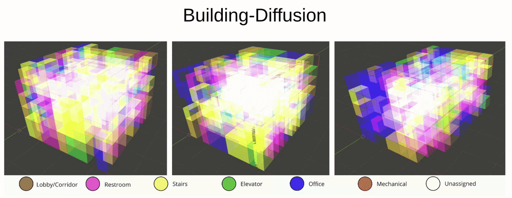

# Building-Diffusion

Official implementation of **Building-Diffusion: Graph Discrete Diffusion Model for Architectural Volumetric Design Generation**.

<p align="center">
  
</p>

📄 **Paper:** [CVPR 2026 Workshop Paper](https://openaccess.thecvf.com/content/CVPR2026W/CV4AEC/html/Sehaba_Building-Diffusion_Graph_Discrete_Diffusion_Model_For_Architectural_Volumetric_Design_Generation_CVPRW_2026_paper.html)

🏆 Accepted at the **CVPR 2026 Workshop on Computer Vision for Architecture, Engineering, and Construction (CV4AEC)**.

## Overview

Building-Diffusion is a graph-based discrete diffusion model for generating 3D building layouts conditioned on architectural program requirements.

The model uses a program graph to guide the generation of semantic labels for nodes in a 3D voxel graph, producing volumetric building layouts. It is trained in two stages:

1. A **self-supervised (SSL) program graph encoder** learns graph embeddings of the program graphs.
2. The **diffusion model** is trained with the frozen SSL encoder, whose graph embedding conditions the denoising of the voxel labels.

## Installation

Tested with Python 3.11, PyTorch 2.1.0 (CUDA 11.8) and PyTorch Geometric 2.6.1, on Ubuntu.

```bash
conda create -n building-diffusion python=3.11
conda activate building-diffusion

pip install -r requirements.txt  # PyTorch (CUDA 11.8 wheels), PyG and the other dependencies
pip install -e .                 # the building_diffusion package, so that the scripts can import it
```

For 3D visualization, install Blender (tested with Blender 3.6):

```bash
sudo apt update
sudo apt install blender
```

## Dataset

The experiments use the **Building-GAN 6-type dataset**, containing 120,000 synthetic buildings. Download it and preprocess it from the repository root (about 12 GB raw and 23 GB processed):

```bash
mkdir -p Data
wget -O Data/6types-raw_data.zip https://d271velnk8wqmg.cloudfront.net/6types-raw_data.zip
unzip -q Data/6types-raw_data.zip -d Data

python scripts/preprocess.py
```

- `Data/6types-raw_data/6types-raw_data/`: the raw dataset, with `global_graph_data/`, `local_graph_data/` and `voxel_data/` (`--raw_dir` of the preprocessing script, `data.raw_dir` in the configs). The evaluation also reads the raw voxel files, to compute the FAR and TPR of the generated buildings.
- `Data/6types-processed_data/`: one processed graph per building, `data000000.pt` to `data119999.pt` (`--out_dir`, `data.processed_dir`).

The split is fixed: the first 96,000 buildings are split 80/20 into train and validation (seeded), and buildings 96,000 to 119,999 are the test set.

## Project layout

```
building_diffusion/        Python package
  constants.py             fixed values of the dataset and of the trained models
  config.py                YAML configs (dataclasses) and command-line overrides
  data/                    graph construction (preprocessing), dataset, data loaders, input features
  models/                  SSL encoder, diffusion model, graph layers, noise scheduler
  diffusion/sampling.py    reverse diffusion (sampling)
  training/                training loops of the SSL and diffusion models, run folders
  evaluation.py            evaluation on the test set
  metrics.py               FAR, TPR and FGW metrics
  utils/plotting.py        training curves and confusion matrices
configs/                   ssl.yaml, diffusion.yaml, evaluate.yaml
scripts/                   preprocess.py, train_ssl.py, train_diffusion.py, evaluate.py
tools/blender/             Blender visualization scripts
```

## Configuration

Run all commands from the repository root. Each script reads one YAML file from `configs/`:

| Script | Config |
|---|---|
| `scripts/train_ssl.py` | `configs/ssl.yaml` |
| `scripts/train_diffusion.py` | `configs/diffusion.yaml` |
| `scripts/evaluate.py` | `configs/evaluate.yaml` |

Any value can be overridden on the command line with `section.key=value`, and `--config <file>` reads another YAML file:

```bash
python scripts/train_diffusion.py model.layer_name=GATv2 train.epochs=1
```

Every key must be present in the YAML file; unknown keys, missing keys and values of the wrong type stop the script with an error. Booleans are `true` / `false`.

## Training

### 1. SSL program graph encoder

```bash
python scripts/train_ssl.py
```

The SSL embedding size is the last value of `model.hidden_channels` (64, 128 or 256; the default config uses 256). Training stops early after `0.2 x epochs` epochs without improvement of the validation loss, and the best model is saved to `runs/<run_id>/checkpoints/best_ssl_model.pt`.

### 2. Diffusion model

Pass the trained SSL model with `model.ssl_checkpoint`:

```bash
python scripts/train_diffusion.py model.ssl_checkpoint=runs/<ssl_run_id>/checkpoints/best_ssl_model.pt
```

- The SSL embedding size is the first value of the diffusion model's `model.hidden_channels`: it must match the trained SSL model (256 in the default configs).
- With `model.ssl_checkpoint: null`, the default path for that size is used (`runs/Jun01_07-02-01_GATv2_5_256/checkpoints/best_ssl_model.pt` for 256, see `DEFAULT_SSL_CHECKPOINTS` in `building_diffusion/models/diffusion.py`).
- The SSL weights are saved inside the diffusion checkpoint, so the SSL file is no longer needed after training.

The default `configs/diffusion.yaml` trains the model used in this README: GAT layers, hidden size 256, 3 layers, 500 diffusion steps and 1000 epochs (run folder `runs/dm_<date>_GAT_256_3_500_1000`). All epochs are trained, and the model with the lowest validation loss is kept. Every 100 epochs and at the end of training, the model generates the first test batch only (32 buildings) with the full reverse diffusion process; use `scripts/evaluate.py` for the whole test set.

### Run folders

Each training run writes `runs/<run_id>/`:

- `config.yaml`: the resolved config of the run, read by the evaluation.
- Diffusion runs only: `ssl_config.yaml`, the architecture of the frozen SSL encoder (read from the SSL run's `config.yaml`).
- `model_<run_id>.log`: settings, per-epoch losses and accuracies, and final results.
- `checkpoints/`: `best_ssl_model.pt`, or `best_diffusion_model.pt` (plus `diffusion_model_epoch_<N>.pt` every 100 epochs).
- TensorBoard event files (`tensorboard --logdir runs`, after `pip install tensorboard`), loss / accuracy / learning-rate plots and confusion matrices.
- Diffusion runs only: `outputs_best/` (and `outputs_epoch_<N>/`), the generated voxel JSON files of the first test batch (32 buildings) at every timestep, which can be visualized with Blender (about 1 GB per test).
- `evaluation_<date>.log`: written by the evaluation script.

## Evaluation

```bash
python scripts/evaluate.py --run runs/dm_Sep28_12-04-04_GAT_256_3_500_1000
```

For every test building, the model generates `eval.num_samples` buildings with the full reverse diffusion process and keeps the one with the lowest FGW distance to the ground truth. The report, written to `runs/<run_id>/evaluation_<date>.log`, gives the mean over the test set of:

- **TPR similarity** (`Test TPR Loss (max.)`, higher is better): cosine similarity between the generated and target program ratios.
- **FAR distance** (`Test FAR Loss (min.)`, lower is better): relative error of the generated floor area ratio.
- **FGW distance** (lower is better): fused Gromov-Wasserstein distance between the generated and true voxel graphs.

Settings (`configs/evaluate.yaml`): `eval.num_samples` (default 1), `eval.seed` (default 1), and the data folders and split. The model settings are read from the run's `config.yaml`; the diffusion checkpoint contains the SSL weights, so no SSL checkpoint is needed.

### Reproducing the paper numbers

- Evaluate the trained run with the same `eval.num_samples` and `eval.seed` as the reported results. The original evaluation script used the number of samples as the seed: for results obtained with `--num_samples N`, set `eval.num_samples=N eval.seed=N` (the default, 1, matches `--num_samples 1`).
- Run folders trained before `config.yaml` existed are still supported: the evaluation then uses the settings of the original evaluation script (hidden size 256, 3 layers, 8 heads, 500 steps), with the layer name, residual and floor flags read from the training log. Set `eval.layer_name=<name>` if the log does not contain the layer name.
- Training and evaluation seed Python, NumPy, PyTorch (CPU and GPU) and PyTorch Geometric with `train.seed` (default 0) and `eval.seed` (default 1). With a given seed, runs are identical on CPU. On GPU, the scatter operations of the graph layers are not deterministic, so runs differ slightly unless `train.deterministic=true` / `eval.deterministic=true`. Deterministic mode is slower and needs much more GPU memory: the SSL training and the evaluation fit on a 16 GB GPU, but the diffusion training with batch size 32 does not.

## Visualization

Generated buildings can be visualized in 3D with Blender. Render a voxel graph, either a raw voxel JSON or a generated one (`runs/<run_id>/outputs_best/voxel_<id>/voxel_data_<id>_timestep_<t>.json`, where timestep 0 is the final result):

```bash
blender --python tools/blender/voxel_output.py -- Data/6types-raw_data/6types-raw_data/voxel_data/voxel_000064.json
```

Render the program graph of a building:

```bash
blender --python tools/blender/program_graph.py -- Data/6types-raw_data/6types-raw_data/local_graph_data/graph_local_000064.json
```

## Development

`requirements.txt` includes [ruff](https://docs.astral.sh/ruff/) for linting (configured in `pyproject.toml`):

```bash
ruff check .
```

## License

This project is released under the MIT License (see [LICENSE](LICENSE)).

## Citation

If you use this code, please cite our [Building-Diffusion paper](https://openaccess.thecvf.com/content/CVPR2026W/CV4AEC/html/Sehaba_Building-Diffusion_Graph_Discrete_Diffusion_Model_For_Architectural_Volumetric_Design_Generation_CVPRW_2026_paper.html).

```bibtex
@inproceedings{el2026building,
  title={Building-Diffusion: Graph Discrete Diffusion Model For Architectural Volumetric Design Generation},
  author={El Amine Sehaba, Mohammed and Krawczuk, Igor and Miguet, Serge and Marsault, Xavier},
  booktitle={Proceedings of the IEEE/CVF Conference on Computer Vision and Pattern Recognition},
  pages={9450--9459},
  year={2026}
}
```
